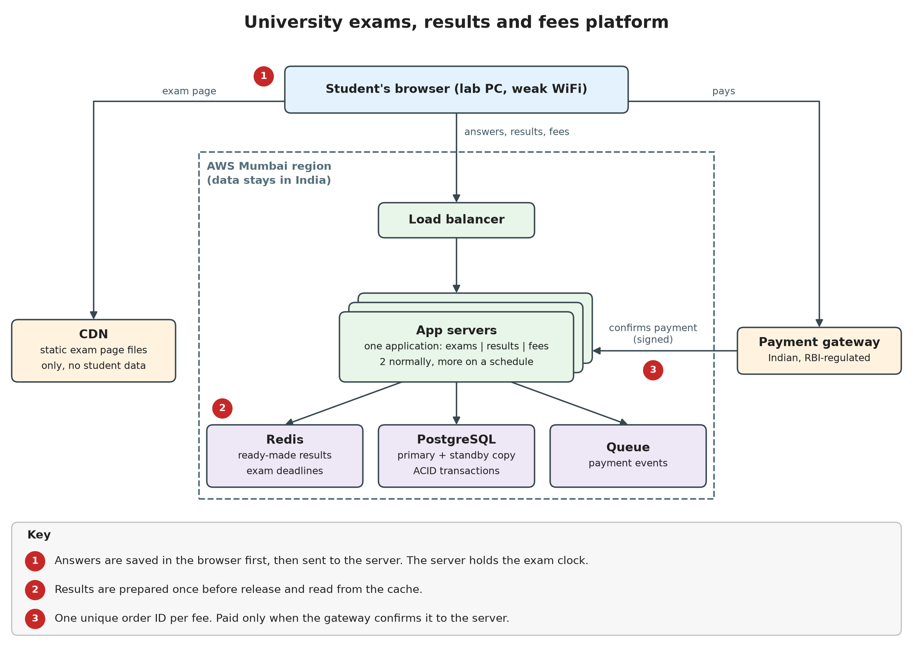

# University Exams, Results, and Fees Platform: System Design

## Load Estimates
- Exam starts: 40,000 students over 15 minutes, averaging approximately 45 starts per second.
- Result access: 1.5 lakh students over 10 minutes, averaging approximately 250 requests per second, with potential peaks of 1,000 requests per second.
- These workloads can be handled by a small number of well-configured servers and a caching layer. They do not require a complex architecture.

## Key Architectural Decisions
- **CDN:** Serves the exam page and associated files. The page is lightweight and simple to ensure fast loading, including on older PCs.
- **Application servers:** Use a single codebase deployed as one unit. Keep the server footprint small during most of the month and scale up on a scheduled basis before known high-traffic events.
- **Managed PostgreSQL:** Stores student records, answers, results, and payments. AWS manages backups and the standby replica.
- **Redis:** Stores precomputed results, exam deadlines, and rate-limit data.
- **Queue:** Buffers work during traffic spikes to prevent data loss.

## Handling Wi-Fi Disconnections During an Exam
- Load the entire question paper once at the beginning of the exam so students can continue reading and answering even if their internet connection drops.
- Save every answer in the browser first, then transmit it to the server asynchronously with its question ID. The server retains only the latest answer for each question, making duplicate submissions harmless.
- When connectivity is restored, the browser resubmits all answers that have not yet been successfully received by the server.
- **Fair time management:** The server, not the student's PC, maintains the authoritative exam clock. Set the deadline on the server when the exam begins, and have the browser display a countdown based on that deadline, re-synchronizing when connectivity is restored.
- Record connection outages through a lightweight heartbeat sent every 30 seconds. Accept late answers only within a short grace period and only when heartbeat records confirm that the connection was interrupted. An invigilator may grant additional time for a recorded outage.

## Handling Result-Day Traffic Without Paying for Peak Capacity All Month
- Results are immutable after release. Therefore, precompute each student's result once before publication and store it in Redis. On result day, application servers retrieve results from the cache without accessing the database.
- Since the release time is known in advance, configure the Auto Scaling group to add servers 30 minutes before publication and remove the additional capacity two hours afterward. This limits the cost of extra servers to a few hours rather than an entire month.
- If traffic exceeds the available capacity, display a brief "you are in the queue" page instead of returning an error.

## Preventing Duplicate or Lost Fee Payments
- **Prevent duplicate charges:** Before a student initiates payment, the server creates a single payment order with a unique ID associated with that student, fee, and term. Subsequent clicks or retries return the existing order rather than creating another one. Enforce a database uniqueness constraint on the payment gateway's payment ID to prevent the same payment from being recorded twice.
- **Never trust the browser:** Mark a payment as paid only after the gateway sends confirmation directly to the server and its signature has been verified. A success message displayed in the browser is not sufficient evidence of payment.
- **Prevent lost payments:** Send payment confirmations through the queue so that deadline-day traffic spikes do not cause them to be dropped. Recheck orders that remain pending after 30 minutes with the payment gateway. Run a nightly reconciliation job that compares internal payment records with the gateway's settlement report and flags discrepancies.
- **Ensure atomic database updates:** Update the payment status and the student's fee record within a single ACID transaction so that either both changes are committed or neither is. Lock the relevant payment row during the update and modify it only if its status is still "pending".
- If the gateway confirmation and an internal recheck arrive simultaneously, one transaction waits for the other, ensuring that the payment is recorded only once. The lock applies only to that individual payment row, so payments belonging to other students are not blocked.
- A database transaction cannot extend to the payment gateway itself. Therefore, the unique order ID and nightly reconciliation remain necessary safeguards.

## Rejected Architectural Choice: Microservices on Kubernetes
I have experience running services on AWS EKS, which is why I would not choose it for this platform. A team of three developers and one part-time operations person cannot reasonably maintain a Kubernetes cluster, manage its upgrades, and operate multiple independent services. The cluster also introduces recurring costs, regardless of how busy the platform is.

The workload is predictable and consists of short, scheduled traffic spikes. Scheduled scaling of a single application is sufficient to handle these demands. The three modules will remain logically separated within the codebase, allowing any module to be extracted into an independent service later if necessary.

## Cost Considerations
Maintain a small server footprint during most of the month and provision additional capacity only for a few scheduled hours around major events. Use managed services so that the operations person does not have to administer databases manually.

Verify the exact monthly cost using the AWS Pricing Calculator. The architecture is designed to remain within a monthly budget of ₹1.2 lakh.

## Architecture

