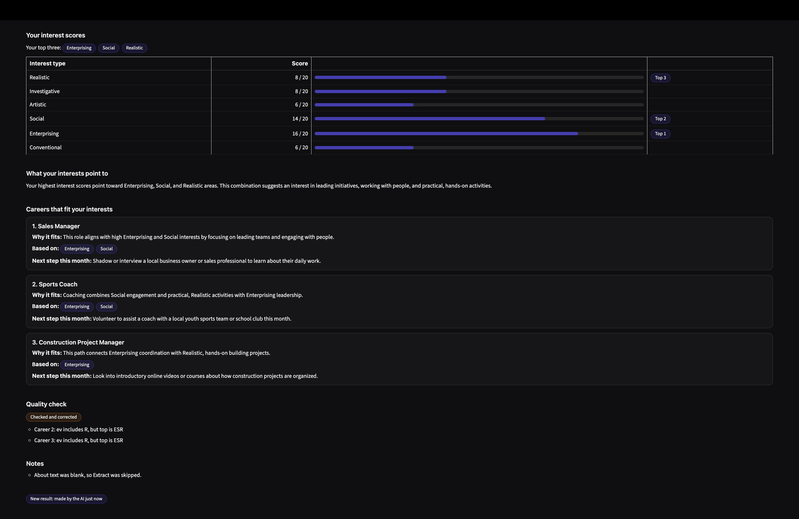
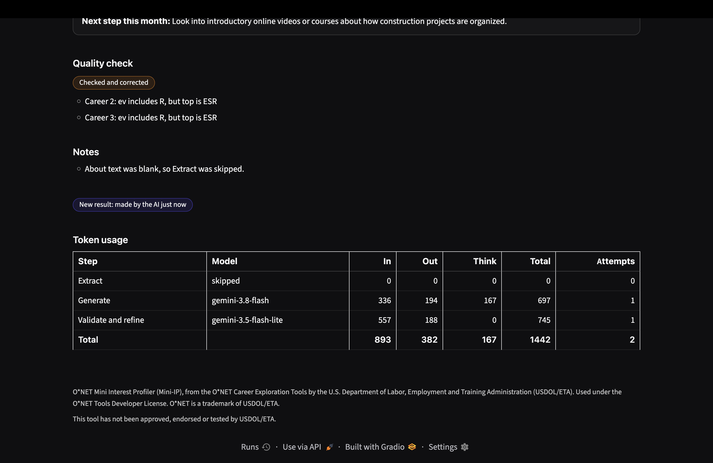
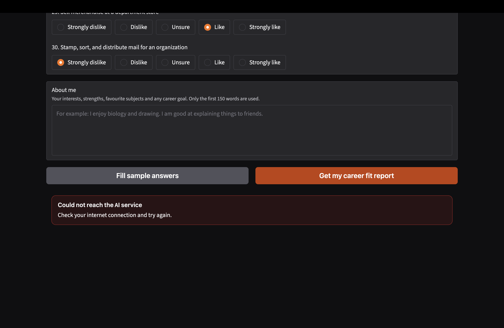

# Career Fit Report

## What this is

A student answers 30 interest questions and writes a few lines about themselves. The app returns three career ideas, and each idea is tied to evidence: one of the student's top interest types, or a fact the student wrote. It is built as one portable AI skill (`SKILL.md`) plus a small web app that runs it. These career ideas are based on the activities you said you enjoy. Use them as a starting point to explore, not as a final answer.

## Screenshots

**Full report**



**Token usage**



**Error state (no internet connection)**



## How to run

These commands are for macOS and Linux. On Windows, use `.venv\Scripts\python` instead of `.venv/bin/python`. The project was built with Python 3.14.

1. Create the virtual environment and install the packages:

   ```bash
   python3 -m venv .venv
   .venv/bin/python -m pip install -r requirements.txt
   ```

2. Add your API key:

   ```bash
   cp .env.example .env
   ```

   Open `.env` and replace `your_key_here` with your Gemini API key. The variable name, `GEMINI_API_KEY`, comes from `api_key_env` in `config.json`.

3. Run the app:

   ```bash
   .venv/bin/python app.py
   ```

   Open the local address it prints. The app listens on 127.0.0.1 only and does not create a public share link.

4. Run the tests:

   ```bash
   .venv/bin/python -m pytest
   ```

5. Run the demo with the fixed sample student from `sample_student.json`:

   ```bash
   .venv/bin/python run_demo.py
   ```

Which commands call the LLM:

| Command | Calls the LLM? |
|---|---|
| `.venv/bin/python -m pytest` | No. Every test uses a fake model or a fake client. |
| `.venv/bin/python app.py` | Only when you click "Get my career fit report" and the result is not in the cache. Up to 3 calls per report, more only on retries. "Fill sample answers" makes no call. |
| `.venv/bin/python run_demo.py` | First run: up to 3 calls, more only on retries. A repeat run: none, because the result is cached. It writes one file under `cache/`. |
| `.venv/bin/python check_adapter.py` | Yes: 2 small calls, one per model tier, with `max_tokens` 20. It writes no files. |

## How it works

```
30 answers ---> scoring.py ---> sc (six scores), top (three letters)    code, 0 tokens
about text ---> trimmed to the first 150 words
                     |
                     v
        cache hit? --yes--> saved result from cache/                      0 tokens
                     | no
                     v
  Step 1  Extract              small model  ---> facts      (skipped if about is blank)
  Step 2  Generate             main model   ---> report     (summary + 3 careers)
          evidence check       code         ---> retry if a career cites made-up evidence
  Step 3  Validate and refine  small model  ---> ok, or corrected careers
          evidence check       code         ---> a bad correction is rejected
                     |
                     v
        save to cache/ ---> render.py (HTML) ---> app.py (Gradio page)
```

Every model step uses the same loop in `pipeline.py` (`run_step`). It builds the system message from `SKILL.md`, sends the input as compact JSON through `llm_adapter.py`, parses the reply, and checks it against the step's JSON Schema. If the reply is not valid JSON, fails the schema, or was cut off by the token limit, the step is retried. The retry sends the same input plus a short note that names the exact error. After `max_retries` retries (2, from `config.json`), the step raises a `StepError`.

**Scoring in code** (`scoring.py`, `questions.json`). Each answer is a number from 0 to 4. The app adds them up per interest type. Each type has 5 questions, so each score is 0 to 20. The three highest types become `top`, with ties broken in the fixed order R, I, A, S, E, C. No model is involved.

**Extract, on the small model** (`SKILL.md` Step 1, run by `pipeline.py`). The model reads the about text and returns only what the student stated: interests, strengths, subjects and a career goal. If the about text is blank, the app skips this call and uses empty facts.

**Generate, on the main model** (`SKILL.md` Step 2, run by `pipeline.py`). The model gets the scores, the top letters and the facts. It writes a two-sentence summary and exactly three careers. Each career has a title, why it fits, 1 to 3 pieces of evidence and one next step for this month.

**Evidence check, in code** (`pipeline.py`, `check_evidence`). Every evidence entry must be a single letter from `top`, or exactly match a fact from Extract. If one does not, the reply is treated as invalid and retried within the same retry limit.

**Validate and refine, on the small model** (`SKILL.md` Step 3, run by `pipeline.py`). The model checks each career. If there are no problems, it returns `ok: true` and empty lists. If there are problems, it lists them and returns three corrected careers. The app replaces the careers and keeps the summary. The corrected careers go through the same evidence check. If they fail, the app keeps the Generate careers and adds a note.

**Cache** (`pipeline.py`). The cache key is a SHA-256 hash of the `SKILL.md` text, both model IDs, the `params` from `config.json`, the answers and the trimmed about text. Each result is saved as `cache/<key>.json`. A repeat of the same input returns the saved result with all token counts set to 0. Editing a prompt, a model ID or a setting gives a new key, so an old result is never returned.

**UI** (`app.py`, `render.py`). `app.py` builds the Gradio page: 30 questions on three tabs, the about box, and two buttons. `render.py` turns the result into HTML: a score table with badges, the summary, one card per career, a review badge, notes, a cache badge and a token table. While a report runs, the page shows a "working" card and the report button is disabled. Failures show a short error card, never a stack trace or the API key.

`skill_loader.py` reads `SKILL.md` and returns the role, rules, and each step's tier, `max_tokens`, prompt and schema.

## Requirements checklist

| Requirement from the brief | File | How |
|---|---|---|
| One portable AI skill file with role, input, output, schema and rules | `SKILL.md` | Plain Markdown with Role, Input, Output and Rules sections, and three steps, each with a prompt and a JSON Schema. No provider-specific features. |
| Works across any LLM and any project | `SKILL.md`, `skill_loader.py` | The app reads prompts and schemas from the skill file at run time. Another project can load the same file. |
| Thin LLM adapter; switching provider means changing config, not code | `llm_adapter.py`, `config.json` | One function makes one OpenAI-compatible chat completions call. Base URL, key variable, model IDs and extra settings all come from `config.json`. |
| Structured JSON output | `SKILL.md` | Every prompt shows the exact JSON shape. Every step has a schema with `additionalProperties: false`, required keys and length limits. |
| Validated, with retry on invalid output | `pipeline.py` | `jsonschema` (draft 2020-12) checks every reply. Invalid or cut-off replies are retried with the error named. A `StepError` is raised after 2 retries. |
| UI renders the JSON as cards, tables or badges | `render.py`, `app.py` | Score table with top-three badges, career cards with evidence badges, review badge, cache badge and token table. |
| Loading and error states | `app.py`, `render.py` | A "working" card and a disabled button while it runs. Separate error cards for a missing key, a failed step, bad answers, rate limits, connection problems and other failures. |
| Three prompts: Extract, Generate, Validate/refine | `SKILL.md` | Steps 1, 2 and 3, each with its own prompt, schema, model tier and `max_tokens`. |
| Token saving: short system prompt | `SKILL.md`, `skill_loader.py` | Each system message is the role, the rules and one short step prompt. |
| Token saving: compact JSON keys | `SKILL.md`, `render.py` | Keys such as `t`, `why`, `ev` and `nxt`. `render.py` shows full labels. |
| Token saving: cheaper model for Extract and Validate | `SKILL.md`, `config.json` | Extract and Validate use the `small` tier; Generate uses `main`. |
| Token saving: caching | `pipeline.py` | The same input is served from `cache/` with 0 tokens. |
| Token saving: max_tokens | `SKILL.md` | A limit per step: 200 for Extract, 800 for Generate and Validate. |

## Token savings, with measurements

These numbers come from one sample student and one run per setting. They are single-run measurements on one sample, not a benchmark.

| Setting | Total tokens per run | Generate total | Generate hidden thinking |
|---|---|---|---|
| Default thinking on the main model | 3,285 | 2,356 | 1,789 |
| `reasoning_effort` set to `low` in `config.json` | 1,508 | 574 | 0 |

- Setting `reasoning_effort` to `low` used about 54% fewer tokens per run. The report still had three fitting careers, and the Validate step found no problems.
- Thinking varies between runs. With `low`, one run used 0 thinking tokens and a later run used 167.
- The default-thinking row was measured with a Generate limit of 4000. The current limit of 800 assumes thinking is set to `low`. With default thinking, Generate needs about 2,000 tokens and would be cut off at 800.
- Extract used about 320 tokens and Validate about 610, both on the small model.
- Validate returned 11 output tokens on a good report, because the skill tells it to return empty lists when nothing needs fixing.
- A repeat of the same input is served from the cache with 0 tokens.

Each saving and where it lives:

- **Thinking level in config.** `config.json` sets `"params": {"main": {"reasoning_effort": "low"}}`. The adapter passes it on to the provider.
- **Short system prompts.** Each step prompt in `SKILL.md` is a few lines. The system message holds only the role, the rules and that one step's prompt (`skill_loader.build_system_prompt`).
- **Compact JSON keys.** The output keys in `SKILL.md` are short (`int`, `str`, `sub`, `goal`, `sum`, `fits`, `t`, `why`, `ev`, `nxt`, `ok`, `iss`, `i`, `p`). `render.py` maps them to full labels in the UI.
- **Compact input JSON.** `pipeline.run_step` sends the input with no extra spaces.
- **Small model for Extract and Validate.** These are the `small` tier in `SKILL.md`, mapped to a model ID in `config.json`.
- **Empty lists when nothing is wrong.** Step 3 in `SKILL.md` returns `{"ok":true,"iss":[],"fits":[]}` for a good report, so a good report is not written out twice.
- **Scoring in code, with zero tokens.** `scoring.py` adds up the answers. The model never calculates scores.
- **Extract skipped when the about text is blank.** `pipeline.run_pipeline` uses empty facts instead of calling the model.
- **About text trimmed to 150 words.** `pipeline.run_pipeline` does this before any call.
- **max_tokens per step.** Set in `SKILL.md`: 200 for Extract, 800 for Generate and Validate. The 800 is an estimate, not a measurement: if every text field were filled to the maximum length the schema allows, the reply would be about 2,400 characters, or roughly 700 tokens. 800 leaves a small margin.
- **Short error notes on retry.** `pipeline.run_step` sends the same input plus a note of at most 300 characters. It does not resend a long history.
- **Cache.** `pipeline.py` saves each result under `cache/`. The same input never calls the model twice.

## Design decisions and why

**A career fit report as the skill.** The model is used only for what code cannot do: reading free text and writing a personal explanation. Everything else is done in code.

**Scores are added up in code, never by the model.** It is plain addition. Code does it for free and gets the same answer every time.

**Schemas live in `SKILL.md`, and the code validates against them.** Prompts and schemas have one source of truth. Another project can reuse the skill without code changes.

**Validation in our own code, not a provider's JSON mode.** `pipeline.py` checks replies with JSON Schema through the `jsonschema` package. It also strips a markdown code fence if the model adds one. No provider feature is needed, so the skill stays portable.

**Every career must cite evidence, and code checks it.** Evidence is a top interest letter or an exact fact from the student's text. `check_evidence` rejects anything else, so the model cannot invent a skill or interest.

**Protection against prompt injection and HTML injection.** Rule 8 in the skill tells the model to treat the student's text as data and never follow instructions inside it. `render.py` escapes all model text and student text with `html.escape` before it goes into the page.

**The thinking level is a config value the adapter does not know about.** `llm_adapter.py` reads `params` for the tier and sends them through the openai package's `extra_body`, which merges them into the request JSON. This works for known and unknown parameter names alike. The adapter refuses a param that would replace a value it sets itself (`model`, `messages` or `max_tokens`).

**One small adapter on the OpenAI-compatible chat completions API.** Many providers offer this API. `llm_adapter.py` makes one call with one system message and one user message, with no tools and no streaming.

**A measured finding about hidden thinking.** With `max_tokens` 20, the main model returned an empty reply, because hidden thinking used up the limit. With 600 it replied correctly. Because of this, the adapter now reports total tokens and the finish reason. The pipeline treats a reply cut off by the token limit as invalid and retries it.

## Switching provider

Only `config.json` changes. The provider must offer an OpenAI-compatible chat completions endpoint. You change:

- `base_url`: the provider's endpoint.
- `api_key_env`: the name of the environment variable that holds the key. Put that variable in `.env`.
- `models.small` and `models.main`: the two model IDs.
- `params`: extra request settings per tier, such as a thinking setting. Use `{}` for none.

Current config:

```json
{
  "provider": {
    "base_url": "https://generativelanguage.googleapis.com/v1beta/openai/",
    "api_key_env": "GEMINI_API_KEY"
  },
  "models": {
    "small": "gemini-3.5-flash-lite",
    "main": "gemini-3.8-flash"
  },
  "params": {
    "small": {},
    "main": {"reasoning_effort": "low"}
  },
  "max_retries": 2
}
```

Example for another provider (placeholders only):

```json
{
  "provider": {
    "base_url": "https://YOUR-PROVIDER-ENDPOINT/v1/",
    "api_key_env": "YOUR_PROVIDER_API_KEY"
  },
  "models": {
    "small": "YOUR-SMALL-MODEL-ID",
    "main": "YOUR-MAIN-MODEL-ID"
  },
  "params": {
    "small": {},
    "main": {"YOUR_PROVIDERS_THINKING_SETTING": "low"}
  },
  "max_retries": 2
}
```

Changing a model ID or a param changes the cache key, so old cached results are not reused.

## Tests

There are 60 tests in 5 files. Run them with `.venv/bin/python -m pytest`.

No test calls a real model. The pipeline and adapter tests replace the model with a fake, and the other tests need no model at all. So the tests cost nothing, need no API key and do not read `.env`.

| File | Tests | What it covers |
|---|---|---|
| `tests/test_skill_loader.py` | 15 | Loads the real `SKILL.md`. Checks:<br>• all three steps exist, with tiers small, main, small<br>• each `max_tokens` is a whole number above 0<br>• each schema is an object schema and each prompt is not empty<br>• the system prompt holds the role, rule 8 and the step prompt<br>• a missing section raises a clear error |
| `tests/test_scoring.py` | 15 | Checks:<br>• 30 items, all zeros gives 0 and all fours gives 20<br>• a hand-made answer list gives hand-computed scores and top letters<br>• ties follow R, I, A, S, E, C<br>• a wrong length or a bad value raises `ValueError` |
| `tests/test_pipeline.py` | 17 | Uses a fake `call_llm` and a temporary cache folder. Checks:<br>• a clean run gives 3 careers, sent as compact JSON with the `max_tokens` from `SKILL.md`<br>• invalid JSON, schema errors, cut-off replies and made-up evidence are retried, and the evidence rules work on their own<br>• replies that are always invalid raise `StepError`<br>• Validate corrections replace the careers and keep the summary, and a bad correction is rejected and noted<br>• a blank about text skips Extract, and long about text is trimmed to 150 words<br>• a repeat run comes from the cache with 0 tokens, and changed params give a new cache key |
| `tests/test_llm_adapter.py` | 6 | Uses a fake OpenAI client. Checks:<br>• params reach the chat completions call, and empty or missing params add nothing<br>• the real `config.json` params are passed on unchanged<br>• a param cannot replace `max_tokens`<br>• through the real openai client with an in-process mock transport, known and unknown params both land in the request JSON |
| `tests/test_render.py` | 7 | Checks:<br>• career cards escape HTML, and three careers give three cards<br>• a letter is shown as its full type name<br>• the think column is total minus in minus out and never negative<br>• a skipped step shows as skipped<br>• review badge text, and score rows with full names and top-three labels |

## Limits and honest notes

- Tested with one provider only: Gemini, on the free tier.
- The measurements are single runs on one sample student.
- The file cache is for one machine. It never expires; delete `cache/` to clear it. Cache files hold the scores, the extracted facts and the report as plain JSON.
- The name of the thinking setting can differ between providers. That is why it lives in `config.json`, not in code.
- The app is a demo. Its use of the questionnaire has not been validated.
- The checker on the small model can be wrong. In two runs, Validate flagged evidence that was correct: once "patience" although "patient" was in the facts, and once the letter R although R was in the top three. Each false alarm cost a full rewrite of the careers. The evidence check in code still tested each rewrite, so nothing invented reached the student. Because code already checks evidence, the Step 3 prompt now tells the checker not to report evidence. This was tested on one run only.
- `requirements.txt` does not pin versions. The code was checked against openai 3.51.0 and gradio 6.32.0.

## Questionnaire source and license

The 30 items are the O*NET Mini Interest Profiler, used unchanged. The source text from `questions.json`:

> O*NET Mini Interest Profiler (Mini-IP), from the O*NET Career Exploration Tools by the U.S. Department of Labor, Employment and Training Administration (USDOL/ETA). Used under the O*NET Tools Developer License. O*NET is a trademark of USDOL/ETA.

This tool has not been approved, endorsed or tested by USDOL/ETA.
License page: https://www.onetcenter.org/license_tools.html

## AI tools used

- Planning and design were done in Claude Chat.
- All code was written by Claude Code from the prompts recorded in `PROMPTS.md`. A few small edits were made by hand, following the plan from Claude Chat: the token limits and one line of the Step 3 prompt in `SKILL.md`, the notice text in `render.py`, `.gitignore`, and later README updates (screenshots, limits and the license link).
- `questions.json` was added by hand from the official O*NET report.
